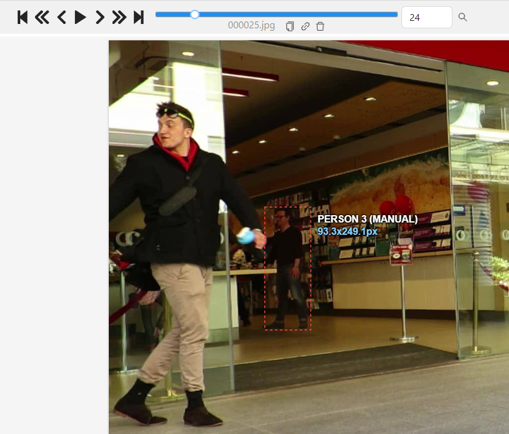
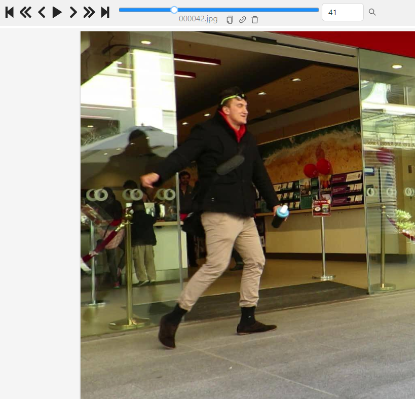
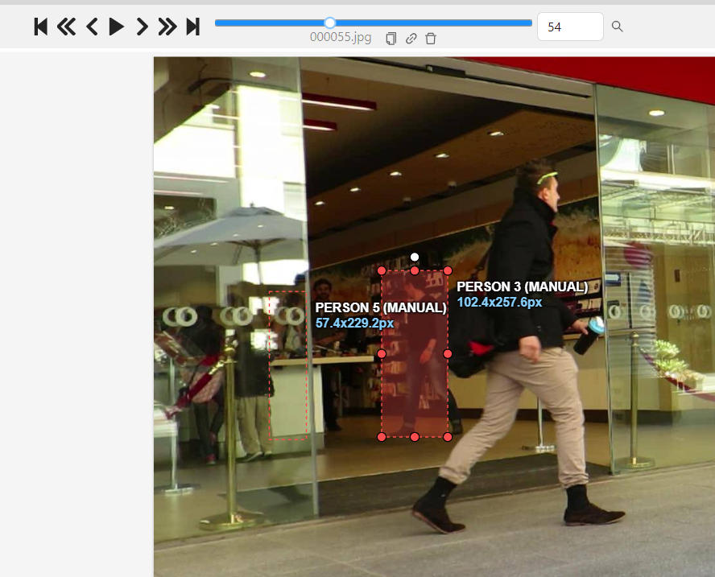

# Báo cáo cá nhân — Nguyễn Việt Quân - 2A202603035

Đổi tên file theo quy tắc `MSSV_HoTen.md`. Ví dụ: `20241234_NguyenVanAn.md`.

Đoạn video: MOT17-09, 150 frame (frame 1–150), nguồn MOTChallenge, giấy phép CC BY-NC-SA 3.0.

## 0. Thông tin học viên

- Họ tên: Nguyễn Việt Quân
- MSSV: 2A202603035
- Mã đề (A/B/C): a
- Email: 26ai.quanv3
- Link repository: https://github.com/JakeNguyen99/K5-L2-DAY05-NguyenVietQuan-2A202603035-MOTTracking
- Giờ bắt đầu: 17:00 13/11/2026
- Giờ kết thúc: 

## 1. Xem trước đoạn video (CP0)

Ghi **trước khi vẽ**, mỗi người một dòng.

| Mã | Frame xuất hiện | Frame cuối thấy được | Rẽ / dừng / đổi tốc độ ở frame | Bị che ở frame | Ghi chú |
|---|---|---|---|---|---|
| P1 |0 | 149| rẽ ở frame 94 | bị che ở frame 43| |
| P2 | 61| 149| rẽ ở frame 89 | bị che ở frame 54| |
| P3 | 0| 149| không rẽ / dừng / đổi tốc độ | không bị che | |
| P4 | 40| 149| không rẽ / dừng / đổi tốc độ | bị che ở frame 0| |
| P5 | 0| 142| dừng ở frame 39 | bị che ở frame 111 | |

## 2. Keyframe và thời gian (CP1, CP4)

Số keyframe lấy từ kết quả `src/check_submission.py`.

| Mã | Số keyframe | Keyframe ở frame | Số frame có mặt | Keyframe / 100 frame | Thời gian (phút) | Chỗ khó |
|---|---|---|---|---|---|---|
| P1 | 15| [0, 10, 20, 30, 50, 60, 70, 80, 90, 100, 110, 120, 130, 140, 149]| 140| 10.7| 0.078| |
| P2 | 11 | [53, 63, 73, 83, 93, 103, 113, 123, 133, 143, 149] | 97 | 11.3 | 0.054| |
| P3 | 16 | [0, 10, 20, 30, 40, 50, 60, 70, 80, 90, 100, 110, 120, 130, 140, 149] | 150| 10.7 | 0.083| |
| P4 | 16| [0, 10, 20, 30, 40, 50, 60, 70, 80, 90, 100, 110, 120, 130, 140, 149]| 150| 10.7| 0,083| |
| P5 | 12 | [0, 10, 20, 30, 40, 50, 80, 90, 100, 110, 139, 140]| 130 | 9.2 | 0.073| |
| **Tổng** | 70| | 667| 52.6| 0.371| |

Keyframe / 100 frame của cả bài = tổng keyframe ÷ tổng số frame có mặt × 100 = 10.5

Bạn đặt keyframe nhiều nhất ở người nào? Vì sao (người đó rẽ, dừng, lại gần camera hay bị che)?
Đặt nhiều keyframe nhiều nhất ở người P3. Vì người đó lại gần camera và là người ở trong khung hình lâu nhất.
...

## 3. Đoạn bị che (CP2)

Người bị che: `P1`

| Mốc | Frame |
|---|---:|
| Bắt đầu bị che một phần (bật `occluded`) | 0 |
| Mất hẳn (bật `outside`) | 40 |
| Hiện lại (tắt `outside`) | 52 |
| Thấy rõ trở lại (tắt `occluded`) | 60 |

- Thời gian khuất hẳn: 11 frame = 0.367 giây.
- Quyết định: giữ cùng ID.
- Lý do (trả lời 3 câu: khuất bao lâu so với 60 frame, ngoại hình có khớp, chỗ hiện lại có đúng hướng và tốc độ): Do chỉ khuất 11 frame so với 60 frame, ngoại hình vẫn khớp, di chuyển đúng hướng.

...

Ảnh chụp màn hình:





## 4. Tự review ID (CP3)

Lượt 1 theo người (đi ngược từ frame 149 về 0 trên CVAT), lượt 2 theo cảnh (nhảy 10 frame). Ít nhất 3 dòng; không có lỗi thì ghi một dòng "đã kiểm hai lượt, không lỗi".

Loại lỗi dùng đúng một trong 7 mã: `id_switch`, `fragmentation`, `lost`, `merge`, `false_track`, `drift`, `flag`.

| Frame | Mã người | Loại lỗi | Mô tả một câu | Phát hiện ở lượt | Đã sửa? |
|---:|---|---|---|---|---|
| | P1 | đã kiểm hai lượt, không lỗi | | | |
| | P2 | đã kiểm hai lượt, không lỗi | | | |
| | P3 | đã kiểm hai lượt, không lỗi | | | |

Tổng hợp số lỗi theo loại:

| `id_switch` | `fragmentation` | `lost` | `merge` | `false_track` | `drift` | `flag` |
|---:|---:|---:|---:|---:|---:|---:|
| | | | | | | |

Lỗi nào chỉ lượt 2 (theo cảnh) mới thấy, lượt 1 (theo người) không thấy? Vì sao?

...

## 5. File xuất và kết quả tự kiểm (CP4)

| Kiểm tra | Kết quả |
|---|---|
| Tên file MOT 1.1 | Đúng 5 track ID |
| Tên file CVAT for video 1.1 | Đọc được 5 track từ annotations.xml. |
| Số track ID khác nhau trong `gt/gt.txt` (phải là 5) | 5 |
| Frame `outside` không có dòng trong `gt.txt` (đúng / sai) | đúng |
| Job đã completed trên CVAT máy cá nhân | đúng |

Dán phần tóm tắt in ra từ `src/check_submission.py`:

```text
Số frame in theo CVAT (bắt đầu từ 0). Trong gt.txt, frame_id = frame CVAT + 1.

=== File MOT 1.1: NguyenVietQuan_mot.zip ===
  Số track ID: 5   |   Tổng số box: 667
  [OK]        Đúng 5 track ID.

  Track | Frame có mặt | Số frame | Đoạn vắng (outside)
      1 |   0–149      |      150 | -
      2 |   0–149      |      150 | -
      3 |   0–149      |      140 | 40–49
      4 |   0–148      |      130 | 120–138
      5 |  53–149      |       97 | -


=== File CVAT for video 1.1: NguyenVietQuan_cvat_video.zip ===

  Track | Nhãn   | Frame thấy | Keyframe | KF/100 frame | Frame occluded | Lần bật outside
      0 | person |        150 |       16 |         10.7 |              0 |               0
              Track 0: keyframe ở frame [0, 10, 20, 30, 40, 50, 60, 70, 80, 90, 100, 110, 120, 130, 140, 149]
      1 | person |        150 |       16 |         10.7 |             70 |               0
              Track 1: keyframe ở frame [0, 10, 20, 30, 40, 50, 60, 70, 80, 90, 100, 110, 120, 130, 140, 149]
      2 | person |        140 |       15 |         10.7 |             50 |               1
              Track 2: keyframe ở frame [0, 10, 20, 30, 50, 60, 70, 80, 90, 100, 110, 120, 130, 140, 149]
      3 | person |        130 |       12 |          9.2 |             20 |               2
              Track 3: keyframe ở frame [0, 10, 20, 30, 40, 50, 80, 90, 100, 110, 139, 140]
      4 | person |         97 |       11 |         11.3 |             50 |               0
              Track 4: keyframe ở frame [53, 63, 73, 83, 93, 103, 113, 123, 133, 143, 149]

  Tổng: 70 keyframe / 667 frame có mặt = 10.5 keyframe / 100 frame
  [OK]        Đọc được 5 track từ annotations.xml.

=== Tóm tắt ===
  Lỗi: 0   |   Cảnh báo: 0
  Đạt. Dán phần tóm tắt này vào báo cáo mục 5.
```

## 6. Ba câu kết

1. Nếu được gán lại, bạn sẽ đặt keyframe khác ở đâu? Vì sao?
Nếu được gán lại thì có thể tăng hoặc giảm tùy vào chuyển động của người đi bộ, hướng, khoảng cách với camera
   ...

2. Có chỗ nào bạn không chắc "cùng ID hay ID mới"? Bạn đã quyết định và ghi chú thế nào?
Không. Quyết định dựa trên guideline.
   ...

3. Một lỗi ID trong job của bạn (nếu không còn sót, chọn lỗi đã sửa) có thể làm xe tự lái dự đoán sai chuyển động của người đó như thế nào? Lỗi đó ảnh hưởng MOTA hay IDF1 nhiều hơn?
- Bộ lọc dự đoán chuyển động của xe tự lái dựa trên lịch sử vị trí của cùng một ID. Khi ID bị nhảy đột ngột sang vị trí khác, điều này có thể dẫn đến tính toán sai và có thể gây hành vi nguy hiểm.
- Lỗi này ảnh hưởng IDF1 nhiều hơn.
   ...

## Bonus (nếu làm)

### B1 — Hai người đi sát

...

### B2 — So cách đặt keyframe

| Cách đặt | Số keyframe | Frame trôi nhất | Ghi chú |
|---|---:|---:|---|
| Đều mỗi 30 frame | | | |
| Theo chỗ đổi hướng | | | |

...

### B3 — So với tracker có sẵn

| Frame | Mã người | Tracker làm gì | Nhãn của bạn | Giải thích (đoán rồi sửa / ghép IoU / box score thấp / ngoại hình) |
|---:|---|---|---|---|
| | | | | |
| | | | | |

## 7. Tài liệu tham khảo và công cụ AI đã dùng

...
